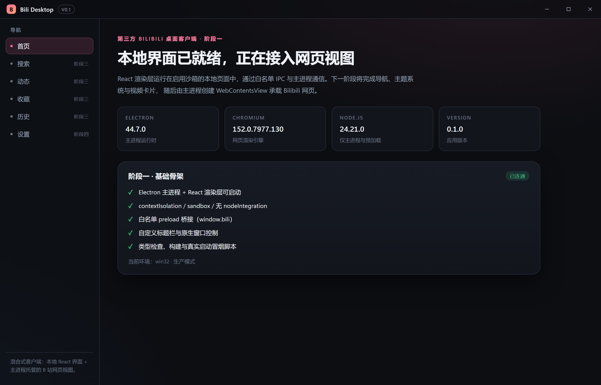

# Bili Desktop

面向 Windows 10/11 的第三方 Bilibili 混合式桌面客户端。本地界面由 React 渲染，Bilibili 网页（视频、搜索、动态、个人空间等）由 Electron 主进程在 `WebContentsView` 中承载，两者在视觉上组合成一个完整应用。

> 当前版本：**V0.1 阶段一（基础骨架）已完成并通过真实启动冒烟测试**。阶段二（桌面 UI / 主题）、阶段三（WebContentsView）、阶段四（设置持久化 / 打包）为后续开发内容，规划见文末路线图。



## 技术栈

| 层 | 选型 |
| --- | --- |
| 桌面壳 | Electron 44.7.0 |
| 本地界面 | React 19 + TypeScript 5.9 + Vite 7 |
| 样式 | 手写 CSS + CSS 变量主题（不引入 Tailwind，保持依赖精简） |
| 主进程 / 预加载构建 | esbuild（输出 CJS） |
| 打包 | electron-builder 26（NSIS 安装包 + 便携目录） |
| 设置存储 | 本地 JSON（阶段四实现），预留后续接入 SQLite |

## 架构

```
┌──────────────────────────── 主进程 (src/main) ────────────────────────────┐
│  window.ts        无边框窗口、窗口状态事件、窗口尺寸/位置记忆（阶段四）      │
│  protocol.ts      app://bundle 自定义协议 + CSP，生产环境加载本地界面        │
│  security.ts      会话加固、来源校验、远程页面导航白名单                    │
│  ipc.ts           白名单 IPC 处理器（校验 event.senderFrame 与窗口 webContents）│
│  web-view-manager.ts  WebContentsView 的创建 / 显示 / 隐藏 / 尺寸同步 / 销毁（阶段三）│
│  data/            视频数据适配层（阶段二接入演示数据源，后续可替换为合法数据源）  │
│  smoke.ts         真实启动冒烟测试（IPC / 渲染 / 截图 / 控制台错误）        │
└──────────────────────────────────────────────────────────────────────────┘
        ▲ 预加载 (src/preload)  contextBridge 暴露最小化 API：window.bili
        ▼ IPC（白名单 channel + 参数校验 + 来源校验）
┌──────────────────────── 渲染进程 (src/renderer) ──────────────────────────┐
│  React 19 + TypeScript：自定义标题栏、左侧导航、页面路由、主题、视频卡片     │
│  沙箱页面：contextIsolation = true, sandbox = true, nodeIntegration = false │
└──────────────────────────────────────────────────────────────────────────┘
        ▲ 同处一个 BrowserWindow，视觉上组合
        ▼
┌──────────────────── WebContentsView（阶段三，由主进程管理） ───────────────┐
│  仅加载 https 的 *.bilibili.com / *.b23.tv 页面；独立非持久 session（不落盘  │
│  登录 Cookie）；导航 URL 校验，阻止非预期跳转与外部协议                    │
└──────────────────────────────────────────────────────────────────────────┘
```

### 目录结构

```
src/
  shared/     主进程与渲染进程共享的类型、IPC 常量、接口约定、URL/参数校验
  main/       主进程：窗口、协议、安全、IPC、设置存储、WebContentsView 管理、冒烟
  preload/    contextBridge 桥接层（只暴露白名单 API）
  renderer/   React 界面（页面、组件、样式、演示数据）
scripts/      dev / build / smoke 等开发脚本
build/        打包产物图标等资源
docs/         文档与截图
```

## 安全设计（V0.1 已落地部分）

- **进程隔离**：主进程与渲染进程分离；主进程独占窗口、IPC、WebContentsView 管理。
- **渲染进程加固**：`contextIsolation: true`、`sandbox: true`、`nodeIntegration: false`、`nodeIntegrationInSubFrames: false`、`webviewTag: false`。
- **IPC 白名单**：每个 channel 显式注册；处理函数校验 `event.senderFrame.url` 与 `event.sender === 主窗口 webContents`，拒绝其他来源。
- **自定义协议**：生产环境通过 `app://bundle` 加载打包后的界面（`standard + secure + supportFetchAPI`），并下发 CSP 响应头，不使用 `file://`，更不关闭 `webSecurity`。
- **远程内容隔离（阶段三）**：Bilibili 页面使用独立、非持久的 Electron session；不设置 `nodeIntegration`；导航仅允许 `https` 且域名为 `*.bilibili.com` / `*.b23.tv`；不抓取、不持久化用户登录 Cookie。
- **最小化预加载 API**：`window.bili` 仅暴露应用信息、窗口控制、设置、主题、网页视图控制、数据读取等白名单方法。

## 开发环境

- Windows 10 / 11（x64）
- Node.js ≥ 22.12（本项目在 Node 24 下开发）
- npm（仓库根 `.npmrc` 已配置 npmmirror 镜像，便于国内下载 Electron 二进制）

```bash
npm install          # 安装依赖（会自动下载 Electron 二进制）
npm run dev          # 启动开发模式：Vite HMR + esbuild watch + Electron
```

## 常用命令

| 命令 | 说明 |
| --- | --- |
| `npm run dev` | 开发模式（Vite dev server + Electron） |
| `npm run typecheck` | TypeScript 全量类型检查（`tsc --noEmit`） |
| `npm run build` | 构建渲染层（Vite）+ 主进程/预加载（esbuild） |
| `npm start` | 用构建产物启动应用（生产模式） |
| `npm run smoke` | **真实启动冒烟测试**：启动应用、跑 IPC/渲染/截图检查并输出报告 |
| `npm run pack` | 生成未打包目录（`release/win-unpacked`，用于快速验证） |
| `npm run build:win` | 生成 Windows NSIS 安装包（输出到 `release/`） |

冒烟报告与截图写入 `artifacts/smoke/<时间戳>/`（`smoke-result.json` + `screenshot.png`）。

### 阶段一真实运行结果（2026-11-07）

```
PASS bridge-exposed               window.bili present in renderer
PASS app-info-over-ipc            renderer=0.1.0 main=0.1.0
PASS renderer-rendered            468 chars inside #root
PASS document-title               Bili Desktop
PASS theme-ipc                    mode=system
PASS window-maximize-round-trip   toggleMaximize() x2 through IPC
PASS native-window-controls       native isMaximized=false after toggle=true
PASS screenshot                   437196 bytes
PASS console-clean                no console errors
PASS no-page-errors               no page-level errors
[smoke] 10/10 checks passed · PASS
```

## 本机环境限制与故障排查

开发机曾出现 Electron 启动即崩溃的问题（退出码 `0x80000003` / `0xC0000005`，发生在任何应用代码执行前）。经对照实验确认为**该机器的 Chromium 进程沙箱 / 用户配置目录不可用**，与本项目代码无关；同一台机器上的其他 Electron 应用也使用 `--no-sandbox` 规避。为此提供两个仅用于受限主机的环境变量：

| 环境变量 | 作用 |
| --- | --- |
| `BILI_NO_SANDBOX=1` | 启动 Electron 时追加 `--no-sandbox`（绕过无法初始化的 Chromium 进程沙箱，仅建议在受限主机/CI 使用） |
| `BILI_USER_DATA_DIR=<绝对路径>` | 把 Chromium 用户数据目录重定向到可写位置 |

```bash
# 受限主机上启动开发模式 / 冒烟测试
BILI_NO_SANDBOX=1 npm run dev
BILI_NO_SANDBOX=1 npm run smoke
```

> 在普通 Windows 10/11 机器上不需要以上变量；`webPreferences.sandbox`、`contextIsolation` 等安全配置始终保持开启。

其他常见问题：

- **npm install 卡住/失败**：`npm_config_cache` 指向项目内 `.npm-cache`；Electron 二进制下载失败可用 `ELECTRON_MIRROR=https://npmmirror.com/mirrors/electron/`。
- **窗口空白**：先 `npm run build`，再 `npm start`；生产模式加载 `app://bundle/index.html`。
- **冒烟测试超时**：查看 `artifacts/smoke/<时间戳>/electron.log`。

## 数据适配层

`src/main/data/` 定义 `VideoSource` 接口与演示数据源 `demo`：首页视频卡片数据来自可替换的演示数据集，后续接入合法、公开可用的数据来源时只需新增适配器实现，界面层不感知来源变化。V0.1 **不使用任何未经验证的非公开接口**作为核心依赖。

## 已知限制（V0.1）

- 收藏夹页面需要登录用户 UID 才能直达，暂以「个人空间」作为收藏入口（登录后可自行进入收藏夹）；后续可通过页面内导航完善。
- 动态 / 收藏 / 历史页面在未登录时展示 Bilibili 官方登录引导，不做 Cookie 抓取或持久化。
- 演示视频数据为静态数据集，尚不包含真实封面图缓存与分页加载。
- 设置持久化（窗口尺寸/位置、主题）与 Windows 安装包构建在阶段四完成。

## 路线图

- [x] **阶段一**：可运行的 Electron + React + TypeScript + Vite 基础项目（类型检查、构建、真实启动冒烟通过）
- [ ] **阶段二**：桌面 UI、左侧导航（首页/搜索/动态/收藏/历史/设置）、浅色/深色/跟随系统主题、视频卡片
- [ ] **阶段三**：`WebContentsView` 接入：视频/搜索/动态/收藏/历史/登录网页、前进后退刷新、加载与错误提示
- [ ] **阶段四**：设置与窗口状态持久化、异常处理、Windows 安装包（electron-builder NSIS）

## 换机 / 迁移到新电脑

项目通过 Git 管理，迁移步骤见下文「用 Git 迁移项目」：在新电脑上 `git clone` 后执行 `npm install` 即可继续开发（`node_modules`、`dist`、`release`、`artifacts` 均不进入仓库）。

```bash
git clone <仓库地址> bili-desktop
cd bili-desktop
npm install
npm run typecheck && npm run build
BILI_NO_SANDBOX=1 npm run smoke   # 受限主机建议带此环境变量；普通机器可省略
```

## 用 Git 迁移到新电脑

仓库已在本机完成 `git init` 与首个提交。迁移到新电脑有两种方式：

**方式 A：通过远程仓库（推荐，方便长期协作）**

```bash
# 当前电脑（在项目根目录）：关联远程并推送
git remote add origin https://github.com/<你的用户名>/bili-desktop.git   # 或在 Gitee 建私有仓库
git push -u origin main

# 新电脑：克隆并安装依赖
git clone https://github.com/<你的用户名>/bili-desktop.git
cd bili-desktop
npm install
npm run typecheck && npm run build
npm run dev
```

**方式 B：离线拷贝（无需远程仓库）**

```bash
# 当前电脑：把仓库打包成单文件 bundle
git bundle create ../bili-desktop.bundle --all

# 把 bili-desktop.bundle 复制到新电脑后：
git clone bili-desktop.bundle bili-desktop
cd bili-desktop
npm install
npm run dev
```

> `node_modules/`、`dist/`、`release/`、`artifacts/` 均被 `.gitignore` 排除，新电脑 `npm install` 后会重新下载 Electron 二进制；仓库根目录的 `.npmrc` 已配置 npmmirror 镜像加速。

日常开发常用的 Git 命令：

```bash
git status              # 查看改动
git add -A              # 暂存全部改动
git commit -m "说明"     # 提交
git log --oneline       # 查看提交历史
git diff                # 查看未暂存改动
git branch              # 查看分支（默认 main）
```

## 许可证

MIT
